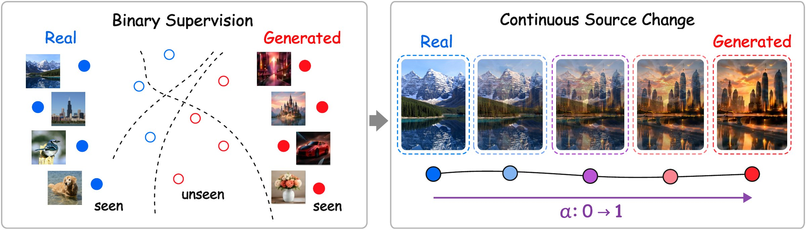
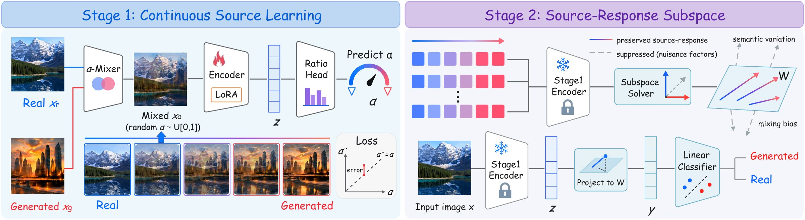

<div align="center">

# 🌗 CuRe

### 学习连续来源响应，实现可泛化的 AI 生成图像检测

[Manni Cui](https://manic-cui.github.io/)<sup>1,2</sup> · Ruiqi Liu<sup>3</sup> · Zijian Yu<sup>1</sup> · Hao Tan<sup>3</sup> · Zibo Wei<sup>2</sup> · Zian Wang<sup>4</sup> · Ziheng Qin<sup>3</sup> · Huijia Zhu<sup>1</sup> · Weiqiang Wang<sup>1</sup> · Jun Lan<sup>1,†</sup> · Shu Wu<sup>3,†</sup>

<sup>1</sup>蚂蚁集团 &nbsp; <sup>2</sup>华中科技大学 &nbsp; <sup>3</sup>中国科学院自动化研究所 &nbsp; <sup>4</sup>吉林大学

<sub>† 通讯作者</sub>

[](https://manic-cui.github.io/projects/cure/)
[](https://arxiv.org/abs/2609.14316)
[](https://huggingface.co/papers/2609.14316)
[](https://huggingface.co/mannicui0/CuRe)
[](LICENSE)
[](https://www.python.org/)
[](https://pytorch.org/)
[](https://github.com/manic-cui/CuRe)

[English](README.md) · [简体中文](README_zh-CN.md)

[🌐 项目主页](https://manic-cui.github.io/projects/cure/) · [📄 论文](https://arxiv.org/abs/2609.14316) · [🤗 Hugging Face](https://huggingface.co/mannicui0/CuRe) · [🧭 方法](#-方法) · [📊 实验结果](#-实验结果) · [🚀 快速开始](#-快速开始) · [📚 引用](#-引用)



</div>

---

> **一句话总结：** CuRe 不再只用真/假两个端点训练检测器，而是让骨干网络学习一张图像中“有多少是生成的”：沿着从真实到生成的连续路径回归混合比例，然后在一个紧凑的来源响应子空间中做分类。仅在 GenImage SD v1.4 上训练，CuRe 在十个公开基准上的平均平衡准确率达到 **89.7%**，比第二名高 **5.2** 个百分点。

现有的 AI 生成图像检测器在同分布数据上往往表现很好，但鲁棒性和跨生成器泛化能力仍然有限，这通常被归因于对捷径特征（shortcut）的过拟合。很多方法试图抑制捷径学习，却大多仍以二分类作为训练任务，没有重新思考训练任务本身如何塑造了学到的表征。

**CuRe**（learning **C**ontinuous So**u**rce **Re**sponses，学习连续来源响应）从训练任务的角度重新审视检测问题。它把骨干适配改写为对真实–生成混合比例的回归，提供比二值端点划分更细粒度的监督；随后选出一个紧凑的来源响应子空间，抑制无关变化，并限制最终分类器接触潜在捷径特征的机会。

---

## 📰 动态

- **2026.10** &nbsp;CuRe 已被集成到阿姆斯特丹大学 VISLab 开源的 AI 生成图像与视频检测工具包 [SynthScope](https://github.com/SMSD75/SynthScope) 中。该团队使用我们发布的 adapter，报告复现了论文中 10 个基准里的 7 个（[在线演示](https://huggingface.co/spaces/SMSD75/SynthScope) · [复现细节](https://github.com/SMSD75/SynthScope/blob/main/models/image/cure/README.md)）。
- **2026.10** &nbsp;在 SynthScope 对 14 个图像检测器的评测中，CuRe 在 6 个近期及真实场景（in-the-wild）基准上的平衡准确率均排名第一，平均 **90.0%**，次优检测器为 72.8%；14 个检测器中有 9 个平均低于 60%（[真实场景评测结果](https://github.com/SMSD75/SynthScope/blob/main/docs/WILD_BENCHMARKS.md) · [LinkedIn 帖子](https://www.linkedin.com/posts/mohammadreza-salehi-39717b108_aigeneratedcontent-deepfakedetection-opensource-share-7517989594106310656-CLQR/)）。
- **2026.10** &nbsp;代码和权重同步发布到 [🤗 Hugging Face](https://huggingface.co/mannicui0/CuRe)，并建立了[论文页面](https://huggingface.co/papers/2609.14316)。
- **2026.09** &nbsp;论文公开于 [arXiv](https://arxiv.org/abs/2609.14316)。
- **2026.09** &nbsp;发布推理代码和训练好的 CuRe adapter（25 MB）。

---

## ✨ 亮点

| | |
|---|---|
| 🎯 **换一个训练任务** | 回归真实–生成的混合比例 $\alpha$，而不是只拟合两个端点的二值标签 |
| 🧭 **来源响应子空间** | 按照对“真实→生成”变化的响应强度（相对于内容变化和同来源混合）选出 128 个方向，而不是按总方差选取 |
| 🏆 **泛化能力强** | 10 个公开基准平均平衡准确率 89.7%，比 DDA（84.5%）高 5.2 个百分点 |
| 🌍 **真实场景** | Chameleon 上 93.8%，RealChain 上 79.7%，分别比第二名高 10.9 和 11.8 个百分点 |
| 🧩 **不依赖特定骨干** | 在 CLIP、DINOv2、DINOv3 和 PE Core（LoRA 秩 16 / 32 / 64）共 12 组设置中，比例监督都优于二值监督，AUC 提升 2.7–9.3 个百分点 |
| 🪶 **轻量发布** | 所有训练参数打包为 25 MB 的 adapter，叠加在公开的 PE Core L/14 骨干之上 |

---

## 🧭 方法

<div align="center">

</div>

**第一阶段 · 连续来源学习。** 随机配对的真实图像 $x_r$ 与生成图像 $x_g$ 在像素空间中按独立采样的比例混合：

$$x_\alpha = (1-\alpha)\,x_r + \alpha\,x_g, \qquad \alpha \sim \mathcal{U}(0,1)$$

PE Core L/14 编码器的预训练参数保持冻结，通过 LoRA（在每个注意力层的 query 和 value 投影上，秩为 64）进行适配。带 sigmoid 输出的比例回归头预测 $\alpha$，以 $\alpha$ 作为软标签、用二元交叉熵训练；训练结束后丢弃该回归头。

**第二阶段 · 抑制干扰的来源响应子空间。** 冻结适配后的编码器，CuRe 在网格 $\alpha \in \lbrace 0, 0.2, \dots, 1 \rbrace$ 上构造真实→生成（RF）、真实→真实（RR）和生成→生成（FF）三类轨迹，并用每条轨迹关于 $\alpha$ 的斜率来概括它。由此得到三个统计量：RF 响应 $C_F$、同来源混合响应 $C_M$，以及样本对之间的内容变化 $C_S$。子空间 $W$ 保留相对于干扰而言 RF 响应最强的 $k = 128$ 个方向：

$$C_F\,w = \gamma\,(\lambda_s C_S + \lambda_m C_M + \epsilon I)\,w$$

**第三阶段 · 子空间约束的分类。** 在 $W^\top(z-\mu)$ 上用交叉熵训练一个线性层，编码器、$\mu$ 和 $W$ 都保持冻结。因此分类器的决策方向被限制在 $\mathrm{span}(W)$ 之内。

---

## 📊 实验结果

十个公开基准上的平衡准确率（%）。CuRe 仅在 GenImage 的 Stable Diffusion v1.4 子集上训练。每个基准的分数是其各评测子集的不加权平均。数字来自论文表 1。

| 方法 | AIGCDetect | AIGIBench | UnivFD | EvalGEN | SynthWildX | WildRF | BFree-On. | RRDataset | RealChain | Chameleon | **总平均** |
|---|---:|---:|---:|---:|---:|---:|---:|---:|---:|---:|---:|
| NPR (CVPR'24) | 63.5 | 63.9 | 53.5 | 86.3 | 47.4 | 51.9 | 46.7 | 49.3 | 50.7 | 54.9 | 56.8 |
| UnivFD (CVPR'23) | 67.4 | 74.7 | 50.8 | 94.5 | 61.6 | 57.3 | 64.9 | 61.2 | 66.1 | 62.1 | 66.1 |
| FatFormer (CVPR'24) | 61.3 | 63.4 | 52.6 | 65.1 | 52.6 | 57.7 | 60.7 | 50.3 | 50.0 | 50.6 | 56.4 |
| C2P-CLIP (AAAI'25) | 78.4 | 69.6 | 91.6 | 66.4 | 55.3 | 59.5 | 50.0 | 52.7 | 50.2 | 50.7 | 62.4 |
| DRCT (ICML'24) | 68.3 | 73.4 | 56.7 | 75.4 | 74.6 | 73.8 | 73.8 | 60.5 | 64.9 | 68.5 | 69.0 |
| SAFE (KDD'25) | 73.0 | 60.2 | 53.0 | 92.8 | 56.0 | 58.5 | 60.8 | 59.3 | 63.4 | 46.7 | 62.4 |
| DDA (NeurIPS'25) | 86.1 | 85.0 | 77.4 | 97.9 | 90.7 | 90.5 | 94.5 | 71.6 | 67.9 | 82.9 | 84.5 |
| GAPL (CVPR'26) | 96.2 | 91.3 | 95.2 | 97.5 | 86.4 | 85.6 | 67.3 | 75.1 | 62.8 | 69.1 | 82.6 |
| DGS-Net (ICML'26) | 77.2 | 60.1 | 78.6 | 53.0 | 50.3 | 53.6 | 50.2 | 50.0 | 50.0 | 50.2 | 57.3 |
| **CuRe（本文）** | 89.3 | 92.8 | 82.0 | 98.1 | 92.7 | 95.8 | 90.9 | 81.5 | 79.7 | 93.8 | **89.7** |

**AIGIBench 上的消融实验**（五个随机种子的均值 ± 标准差；论文表 4 和表 5）：

| 第一阶段监督方式 | B.Acc. | AUC |
|---|---:|---:|
| 二分类（基线） | 80.2 ± 0.6 | 89.2 ± 0.9 |
| 第一阶段比例预测（直接使用） | 89.8 ± 0.3 | 97.2 ± 0.4 |
| **完整 CuRe** | **92.6 ± 0.4** | **97.5 ± 0.7** |

| 第二阶段表征 | B.Acc. | AUC |
|---|---:|---:|
| PCA-128 | 89.8 ± 0.9 | 91.1 ± 0.9 |
| 完整特征 | 89.7 ± 0.4 | 90.5 ± 0.2 |
| $C_M + C_S$ 方向 | 83.2 ± 1.1 | 85.8 ± 0.6 |
| **$C_F$ 子空间（CuRe）** | **92.6 ± 0.4** | **97.5 ± 0.7** |

子集级结果、跨骨干对比，以及对 JPEG 压缩、缩放和模糊的鲁棒性请见论文。

---

## 🚀 快速开始

### 1. 环境配置

需要 Python 3.10 或更高版本。

```bash
git clone https://github.com/manic-cui/CuRe.git
cd CuRe
pip install -r requirements.txt
shasum -a 256 -c weights/cure_adapter.pt.sha256
```

同样的文件也同步在 Hugging Face 上，可以用 `hf download mannicui0/CuRe --local-dir CuRe` 代替 `git clone` 获取。

`weights/cure_adapter.pt`（约 25 MB）随仓库提供，包含 CuRe 的全部训练参数：第一阶段的 LoRA 更新、第二阶段的来源响应子空间（`mu`、`W`）以及线性分类头。

冻结的骨干 Perception Encoder Core L/14（336 px）不在本仓库中。首次使用时会自动从公开的 Hugging Face 仓库 `facebook/PE-Core-L14-336` 下载（文件 `PE-Core-L14-336.pt`，2.7 GB，Apache-2.0），并由 `huggingface_hub` 缓存。如果机器无法访问 Hugging Face，可以把 `HF_ENDPOINT` 设为镜像地址，或者先下载该文件，再通过 `--base-checkpoint /path/to/PE-Core-L14-336.pt` 传入。

### 2. 推理

```bash
python infer.py --input image.jpg
python infer.py --input images --recursive --batch-size 8
python infer.py --input image.jpg --base-checkpoint /path/to/PE-Core-L14-336.pt
```

预测结果以 JSON Lines 格式输出到标准输出。使用 `--output output.jsonl` 保存结果，使用 `--checkpoint` 指定其他 adapter。运行 `python infer.py --help` 查看全部选项。每一行的格式为

```json
{"image": "<相对于 --input 的路径>", "probability_fake": <0 到 1 之间的浮点数>, "prediction": "real" | "fake"}
```

当 `probability_fake` 不小于 0.5 时，`prediction` 为 `fake`。支持的格式：`.jpg`、`.jpeg`、`.jfif`、`.png`、`.webp`、`.bmp`、`.tif`、`.tiff`。

默认在 GPU 上推理（`--device cuda`，或用 `--device cuda:N` 指定显卡），并使用 fp16 自动混合精度，这也是论文中所有结果使用的设置。没有 GPU 的机器可以使用 `--device cpu`，此时以 fp32 计算，分数可能与论文结果在小数点后第三位有差异。

骨干权重和 adapter 会合并为一个 state dict，并以 `strict=True` 加载，缺失或多余的张量都会报错。

---

## 🗂️ 仓库结构

```
.
├── infer.py                  推理入口
├── cure/
│   ├── backbone.py           带 Q/V LoRA 的 PE Core L/14 视觉编码器
│   ├── model.py              CuRe 模型：骨干 + 子空间 + 线性分类头
│   └── preprocess.py         图像预处理
├── weights/
│   ├── cure_adapter.pt       CuRe 的全部训练参数（约 25 MB）
│   └── cure_adapter.pt.sha256
├── assets/                   README 中使用的图片
├── requirements.txt
├── LICENSE
└── NOTICE
```

---

## 📚 引用

如果 CuRe 对你有帮助，欢迎引用：

```bibtex
@article{cui2026cure,
  title   = {Learning Continuous Source Responses for Generalizable {AI}-Generated Image Detection},
  author  = {Cui, Manni and Liu, Ruiqi and Yu, Zijian and Tan, Hao and Wei, Zibo and Wang, Zian and Qin, Ziheng and Zhu, Huijia and Wang, Weiqiang and Lan, Jun and Wu, Shu},
  journal = {arXiv preprint arXiv:2609.14316},
  year    = {2026}
}
```

---

## 📬 联系方式

- **Issues** &nbsp;[github.com/manic-cui/CuRe/issues](https://github.com/manic-cui/CuRe/issues)
- **邮箱** &nbsp;`mannicui@berkeley.edu`
- **个人主页** &nbsp;[manic-cui.github.io](https://manic-cui.github.io/)

---

## ⚖️ 许可证

代码以 [Apache License 2.0](LICENSE) 发布。PE Core 视觉编码器的实现改编自 Meta 的 [Perception Encoder](https://github.com/facebookresearch/perception_models)（Apache-2.0），署名信息见 [NOTICE](NOTICE)。
